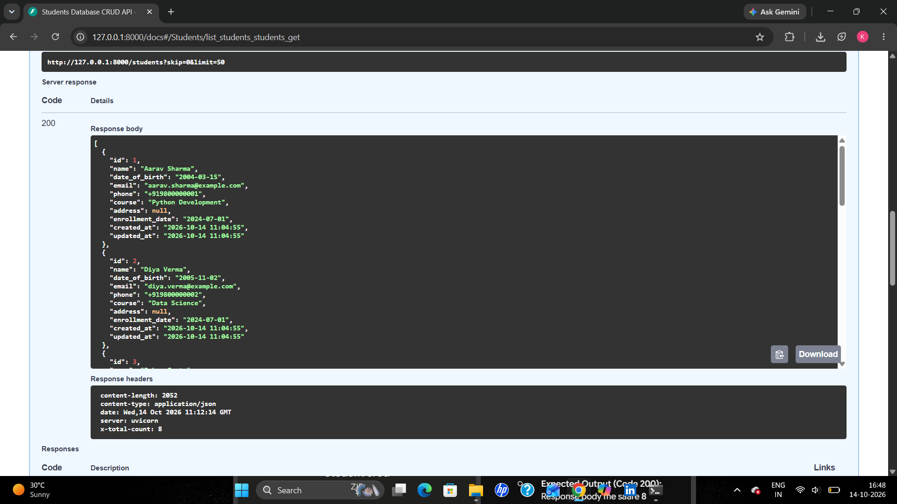
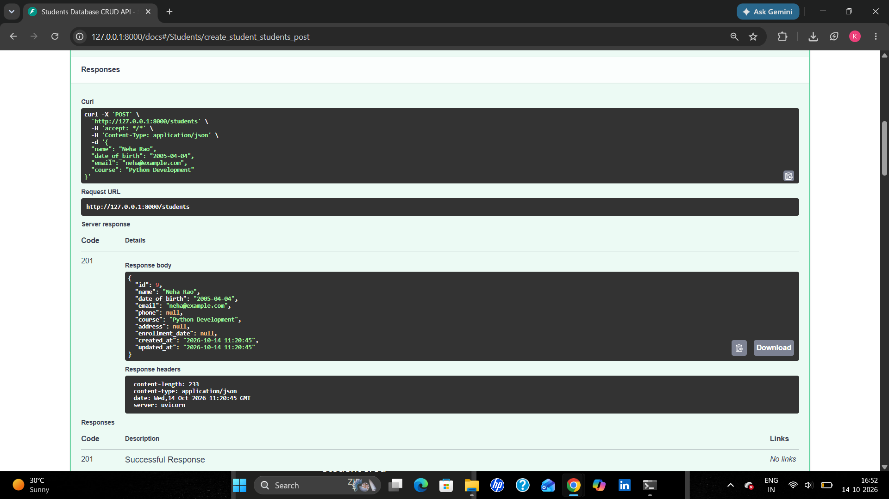
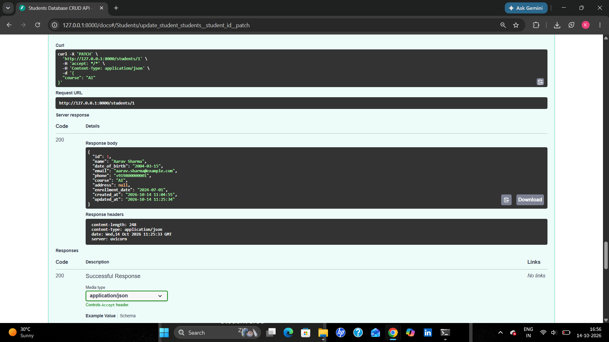
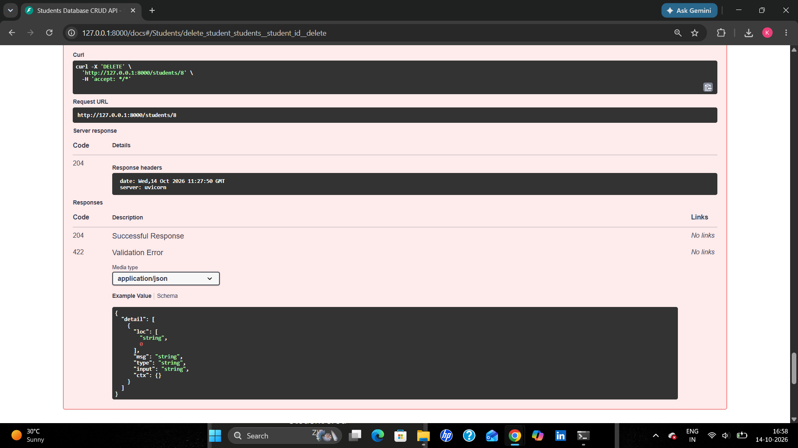
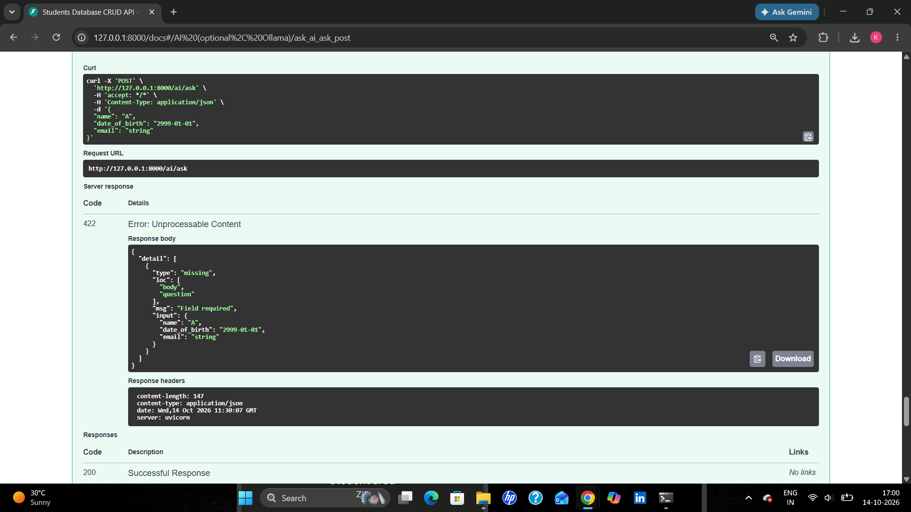

# Students Database CRUD API

Python backend for managing student records: **FastAPI + SQLite**, with an **optional local-AI extension (Ollama)**.
Built as the EWB Edu Tech internship project (Python Backend Development).

## Features
- Full CRUD: create, list/filter, view, update (PUT + PATCH), delete
- Persistent storage in a SQLite file (`students.db`, created automatically)
- Input validation (email/phone format, DOB not in future, at least one contact) and clean errors (404 / 409 / 422)
- Filtering + pagination on the list endpoint
- Auto-generated interactive docs at `/docs`
- Automated tests (`pytest`, 22 tests)
- Optional: ask natural-language questions about the data through a local Ollama model

## Prerequisites
- Python 3.10+
- (Optional, AI bonus only) [Ollama](https://ollama.com/download)

## Installation
```bash
git clone <your-repo-url>
cd <repo-folder>

python -m venv venv
# Windows:      venv\Scripts\activate
# Linux / Mac:  source venv/bin/activate

pip install -r requirements.txt
```

## Run
```bash
uvicorn app.main:app --reload
```
- API: http://127.0.0.1:8000
- Interactive docs (test everything from the browser): http://127.0.0.1:8000/docs

Optional: load 8 **dummy** students for demo
```bash
python seed.py
```

## Student fields
| Field | Required | Notes |
|---|---|---|
| `id` | auto | unique, auto-incremented |
| `name` | yes | 2-100 chars |
| `date_of_birth` | yes | `YYYY-MM-DD`, not in the future |
| `email` | one of email/phone | unique, stored lowercase |
| `phone` | one of email/phone | 7-15 digits, optional leading `+` |
| `course`, `address`, `enrollment_date` | no | |

## API endpoints
| Method | Endpoint | Purpose |
|---|---|---|
| POST | `/students` | Create a student (201) |
| GET | `/students` | List / filter students |
| GET | `/students/{id}` | View one student |
| PUT | `/students/{id}` | Replace all details |
| PATCH | `/students/{id}` | Update only the fields sent |
| DELETE | `/students/{id}` | Delete (204) |
| POST | `/ai/ask` | Optional: ask a question about the data |

**List filters (query params):** `name`, `course` (partial match), `email` (exact), `born_after`, `born_before` (`YYYY-MM-DD`), `skip`, `limit` (max 200).
Total matches are returned in the `X-Total-Count` response header.

## Testing the API (curl)
```bash
# Create
curl -X POST http://127.0.0.1:8000/students -H "Content-Type: application/json" \
  -d '{"name":"Aarav Sharma","date_of_birth":"2004-03-15","email":"aarav@example.com","phone":"+919800000001","course":"Python"}'

# List all / filter
curl http://127.0.0.1:8000/students
curl "http://127.0.0.1:8000/students?course=python&born_after=2003-12-31"

# View one
curl http://127.0.0.1:8000/students/1

# Partial update
curl -X PATCH http://127.0.0.1:8000/students/1 -H "Content-Type: application/json" -d '{"course":"Data Science"}'

# Delete
curl -X DELETE http://127.0.0.1:8000/students/1
```
Windows PowerShell users: easiest is to use the browser at `/docs` ("Try it out").

### Error handling
| Situation | Response |
|---|---|
| Student id not found | `404` with message |
| Duplicate email | `409` |
| Invalid data (bad email, future DOB, no contact, ...) | `422` with details |

## Run the automated tests
```bash
pytest -q
```
Tests use a temporary database, so your real `students.db` is never touched.

## Optional bonus: local AI with Ollama
```bash
ollama pull llama3.2:1b      # one-time download
ollama serve                 # skip if Ollama is already running
python seed.py               # some dummy data to ask about
```
```bash
curl -X POST http://127.0.0.1:8000/ai/ask -H "Content-Type: application/json" \
  -d '{"question":"List students born after 2005"}'
```
Other examples: `"How many students are there?"`, `"Who is in Data Science?"`, `"Show students named Aarav"`.

**How it works (and why it is safe)**
1. The backend reads the question and decides what to fetch (year filters, course, name) using **parameterised queries** in `app/crud.py`.
2. Only those records plus a few computed facts (total count, matched count, filters applied) are sent to the model as context.
3. The system prompt tells the model to answer **only** from that context.
4. The model **never writes or executes SQL**.

The response includes `facts` and `records_used` so you can verify the answer against the data.
If Ollama is not running the endpoint returns `503` with instructions. The CRUD API works fully without Ollama.
Settings can be changed via environment variables (see `.env.example`): `OLLAMA_URL`, `OLLAMA_MODEL`, `STUDENTS_DB`.

## Project structure
```
app/
  main.py             FastAPI app, startup (creates table), router registration
  database.py         SQLite connection + table schema
  schemas.py          Pydantic models: validation + response shape
  crud.py             All SQL queries (parameterised)
  routes_students.py  /students endpoints
  ai_service.py       Optional: record retrieval + Ollama call
  routes_ai.py        Optional: /ai/ask endpoint
tests/                pytest tests (CRUD + AI with mocked Ollama)
seed.py               Dummy data loader
requirements.txt
```
## Screenshots

### 1. List Students


### 2. Create Student


### 3. Update Student (Patch)


### 4. Delete & 404 Error


### 5. Validation Error


## Security notes
- Only dummy data is used; no real student information and no secrets are committed (`*.db` and `.env` are git-ignored).
- All SQL uses placeholders, so SQL injection is not possible through the API.
